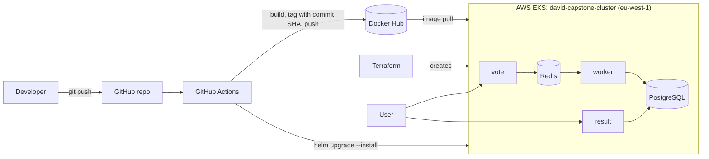
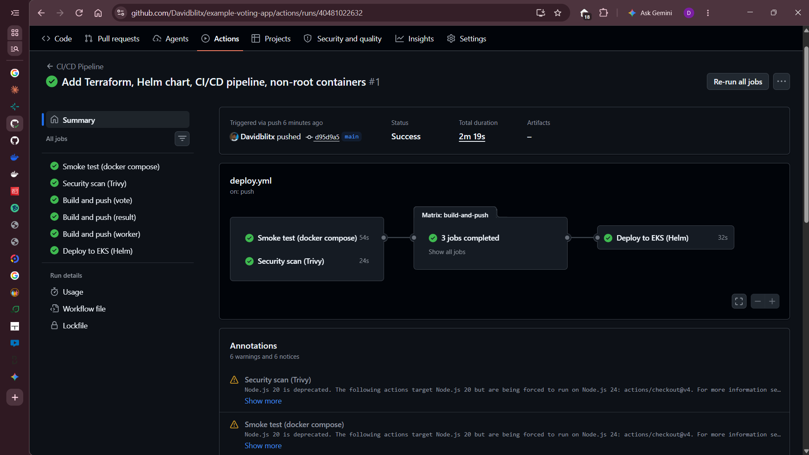
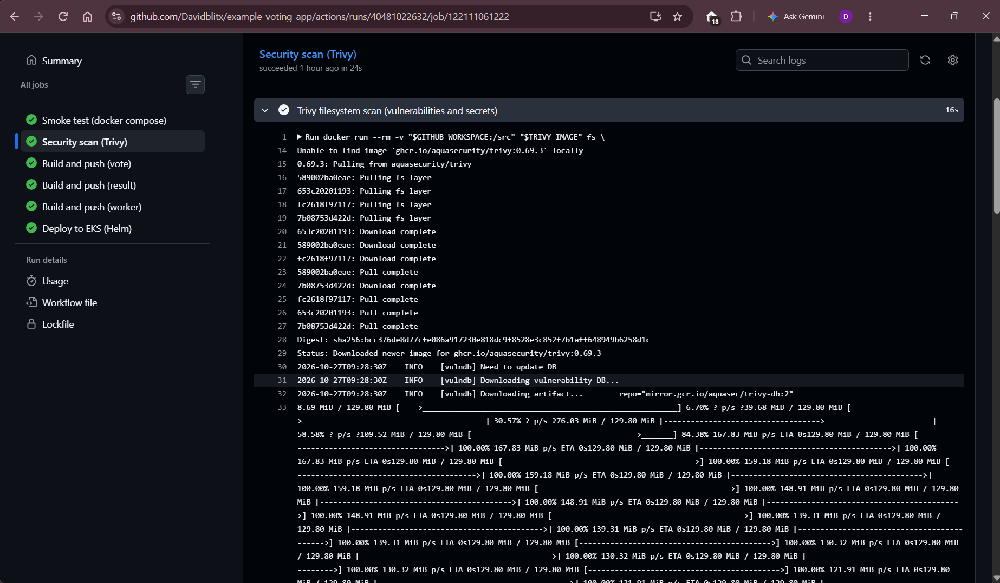
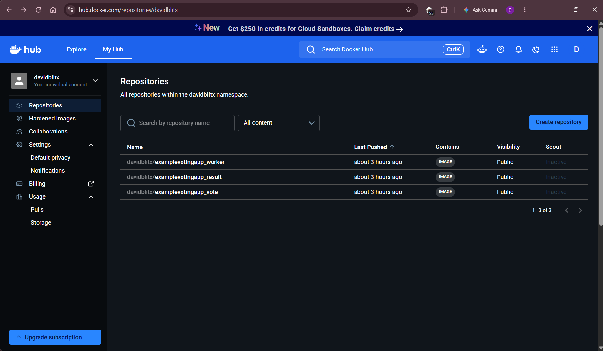
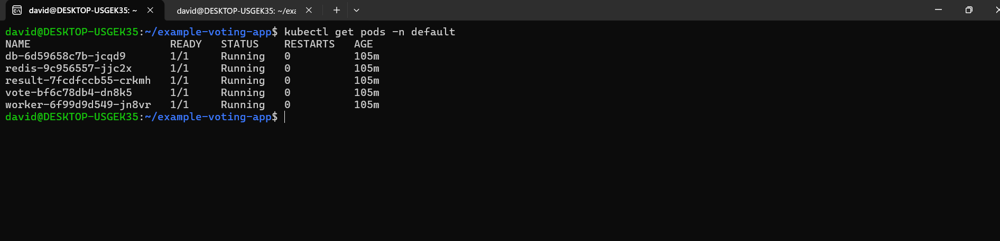
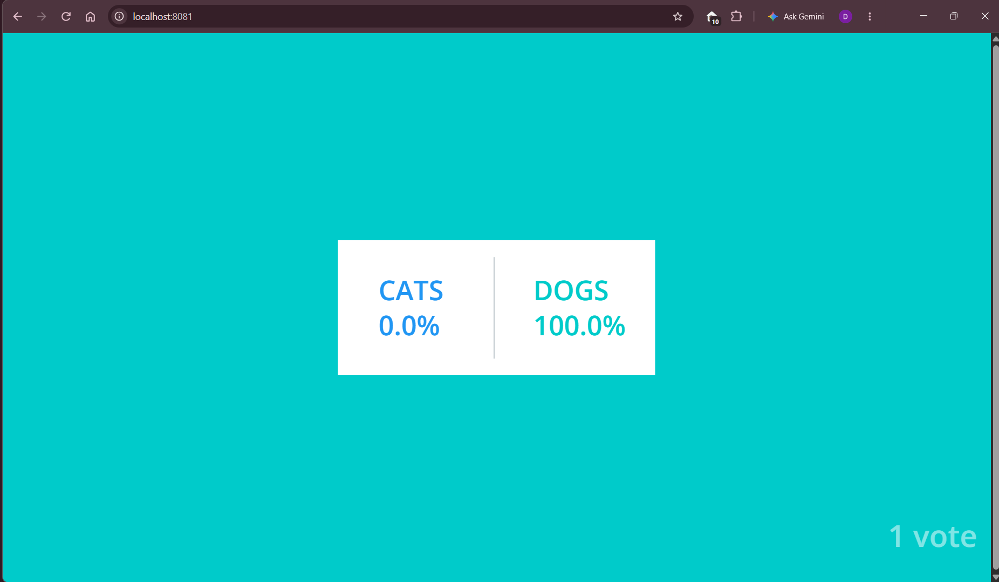
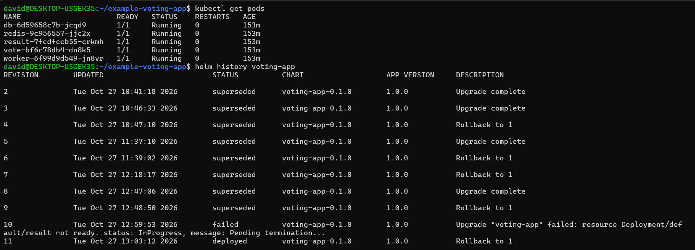
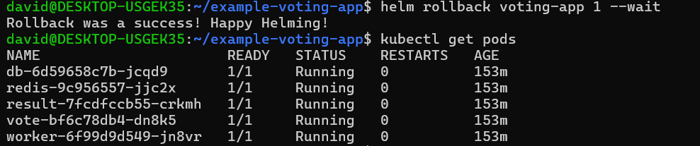

# Capstone 1: Ship It (Voting App on EKS)

Fork of [dockersamples/example-voting-app](https://github.com/dockersamples/example-voting-app), taken from a local `docker compose` demo to an automatically deployed service on AWS EKS.

One push to `main` now tests, scans, builds, pushes and deploys the app. The whole environment can be destroyed and rebuilt from code in about 10 minutes.

## Architecture



How a vote travels: the vote page puts the vote in Redis, the worker moves it into PostgreSQL, and the result page reads the totals from PostgreSQL.

## What is in this repo

| Path | Purpose |
|---|---|
| `vote/`, `result/`, `worker/` | The three app services and their Dockerfiles |
| `terraform/` | EKS cluster in the default VPC, plus IAM roles and a managed node group |
| `helm/voting-app/` | One Helm chart and one values file for all five workloads |
| `.github/workflows/deploy.yml` | The CI/CD pipeline |
| `docs/screenshots/` | Evidence for each step |

## Infrastructure (Terraform)

- Region `eu-west-1`, cluster `david-capstone-cluster`, Kubernetes 1.34
- Managed node group of 2 x `t3.large` (min 1, max 3), in the default VPC
- The kit defaults were changed: `t3.small` was too small for Capstone 2, and Kubernetes 1.30 is no longer offered

```bash
cd terraform
terraform init
terraform plan -out=tfplan
terraform apply tfplan
aws eks update-kubeconfig --name david-capstone-cluster --region eu-west-1
kubectl get nodes
```

### Rebuild from code

I destroyed the cluster with `terraform destroy` and recreated it with `terraform apply`, twice.

| Step | Time |
|---|---|
| Destroy | node group about 8 minutes, cluster about 2.5 minutes (10 resources) |
| Recreate | cluster 8m04s, node group 1m44s, total 9m57s (10 resources) |

After the recreate, a push to `main` redeployed the app with no manual steps beyond adding the GitHub secrets.

## Containers

- Base images are pinned to a version tag (`python:3.11-slim`, `node:18-slim`, `dotnet/sdk:7.0` and `dotnet/runtime:7.0`)
- Every service runs as a non-root user: `vote` and `worker` as uid 10001, `result` as the `node` user
- Each service has a `.dockerignore`
- The production image of `vote` is the `final` stage (gunicorn), not the `dev` stage that docker compose uses
- Non-root processes cannot bind port 80 on Kubernetes by default, so the `vote` and `result` pods set the sysctl `net.ipv4.ip_unprivileged_port_start=0`

## Pipeline (GitHub Actions)

`.github/workflows/deploy.yml` runs on every push to `main`:

1. **Smoke test:** brings up the stack with docker compose and checks that the vote and result pages respond. The upstream project has no unit tests, so this is the test that exists.
2. **Trivy scan:** scans the repository for vulnerabilities and secrets (CRITICAL and HIGH, unfixed ignored). It runs in report-only mode and does not fail the build yet. Trivy runs from a pinned container image instead of the trivy-action.
3. **Build and push:** three parallel jobs build `vote`, `result` and `worker` and push them to Docker Hub as `davidblitx/examplevotingapp_<service>:<commit SHA>` (plus `latest`).
4. **Deploy:** configures AWS credentials, connects to the cluster and runs `helm upgrade --install` with `--set global.tag=<commit SHA>`, so the cluster always runs the exact commit that was built.

Jobs 3 and 4 only run on pushes to `main`. A full run takes about 2m20s.





### Secrets

No secrets are stored in Git. These GitHub Actions secrets are used: `DOCKERHUB_USERNAME`, `DOCKERHUB_TOKEN`, `AWS_ACCESS_KEY_ID`, `AWS_SECRET_ACCESS_KEY`. Terraform state, plan files and the `.terraform/` directory are excluded by `terraform/.gitignore`.

## Deploy and use

After a push, the pipeline deploys automatically. To check it and open the app:

```bash
kubectl get pods
kubectl port-forward svc/vote 8080:5000
kubectl port-forward svc/result 8081:5001
```

Vote at http://localhost:8080 and watch the totals at http://localhost:8081.




## Rollback

I shipped a bad release on purpose by pointing the chart at an image tag that does not exist:

```bash
helm upgrade voting-app ./helm/voting-app --set global.tag=doesnotexist --wait --timeout 60s
kubectl get pods
helm history voting-app
helm rollback voting-app 1 --wait
```

What happened:

- Helm reported `UPGRADE FAILED` after 60 seconds, and revision 10 was marked `failed`
- The new pods sat in `ImagePullBackOff`, while the old pods kept running, so the app stayed up
- `helm rollback voting-app 1` restored the last good release as revision 11, and all five pods were healthy again




## Known limitations

- **Database password:** the PostgreSQL credentials are the upstream defaults (`postgres`/`postgres`) and appear in `helm/voting-app/values.yaml`. The upstream application hardcodes them, so changing them would mean changing application code. The database is a `ClusterIP` service and is not reachable from outside the cluster.
- **Trivy is report-only:** it scans repository files, not the built images, and it does not block the build. Gating on image scans is the next step.
- **End-of-life base images:** Node 18 and .NET 7 are past end of life. They were kept so the application builds unchanged.
- **AWS credentials:** the pipeline uses long-lived access keys stored as GitHub secrets. OIDC with a short-lived role would be the better production setup.
- **Access to the app:** the services are exposed with port-forward for the demo. Ingress and a load balancer were left out of scope.
